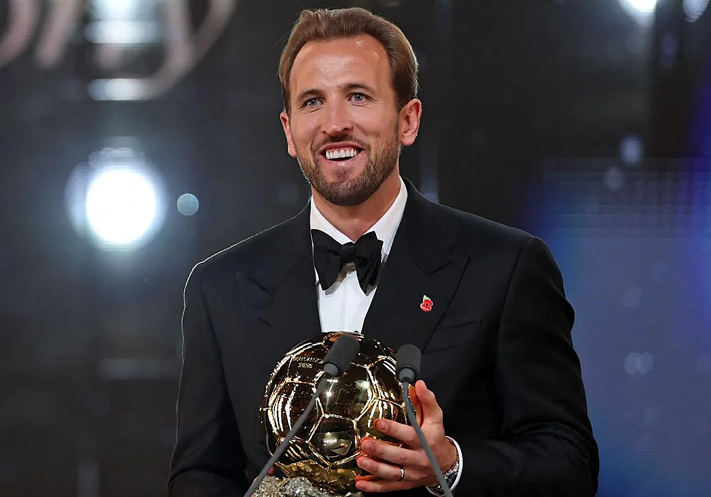

# Harry Kane, Balón de Oro 2026

## El premio que tardó 25 años en volver a Inglaterra

El **26 de octubre de 2026**, en el London Palladium, *Harry Kane* (Bayern de Múnich e Inglaterra) ganó el Balón de Oro. Es el primer inglés que lo consigue desde Michael Owen en 2001. En la votación quedó por delante de Kylian Mbappé y Lamine Yamal. El premio lo organiza `France Football` junto con la UEFA desde 2024.



## Por qué ganó

Kane llegó a la gala tras una temporada de más de 70 goles entre club y selección, la mejor de su carrera. Sus puntos fuertes fueron:

- Goles: máximo goleador de la temporada.
- Liderazgo: capitán de Inglaterra y referente del Bayern.
- Regularidad: llevaba años entre los mejores sin llegar a la cima.

## Pasos de la votación

Los periodistas votan siguiendo tres criterios, de más a menos importancia:

1. Rendimiento individual, decisivo e impresionante.
2. Rendimiento del equipo y títulos conseguidos.
3. Clase y juego limpio.

## Un ejemplo en código

Así se podría representar el podio de 2026 en Python:

```python
podio_2026 = {
    1: "Harry Kane",
    2: "Kylian Mbappé",
    3: "Lamine Yamal",
}

for puesto, jugador in podio_2026.items():
    print(f"{puesto}º - {jugador}")
```

## Kane en el Balón de Oro a lo largo de los años

| Año | Posición | Club |
|-----|----------|------|
| 2017 | 10º | Tottenham |
| 2018 | 10º | Tottenham |
| 2021 | 23º | Tottenham |
| 2025 | 13º | Bayern de Múnich |
| 2026 | 1º | Bayern de Múnich |

## Más información

- Perfil del jugador: [Harry Kane en Wikipedia](https://es.wikipedia.org/wiki/Harry_Kane)
- Documento secundario del proyecto: [Ver detalles](docs/detalles.md)

## Mi instituto

.jpg)
